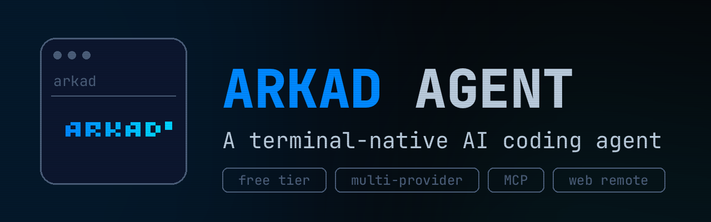
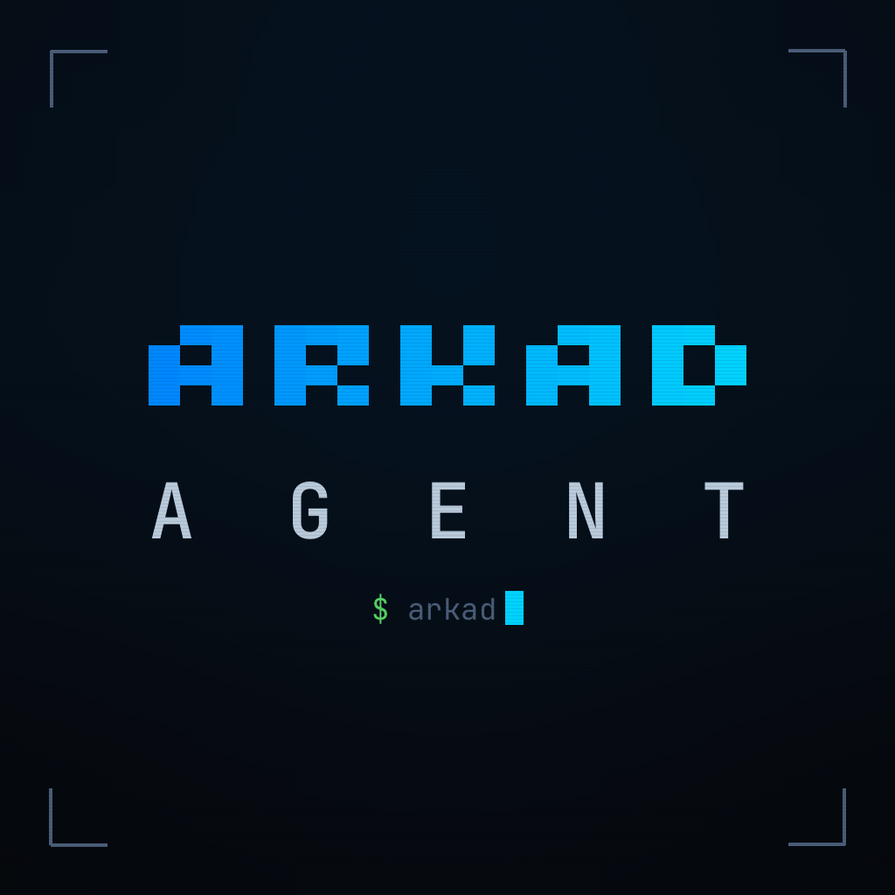
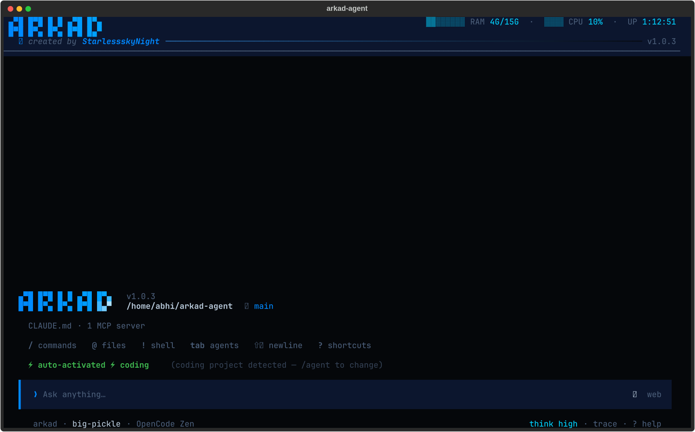
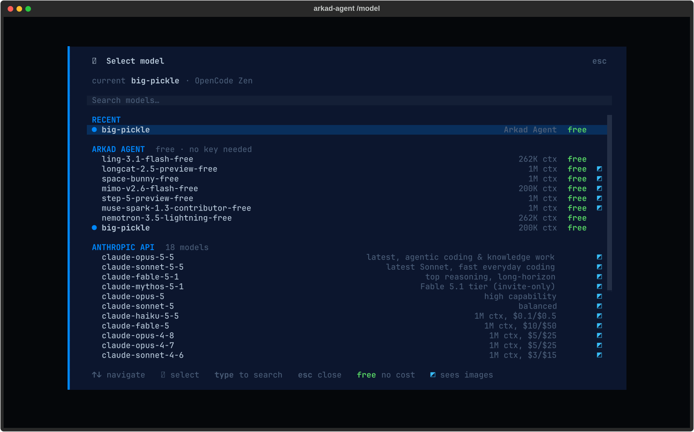
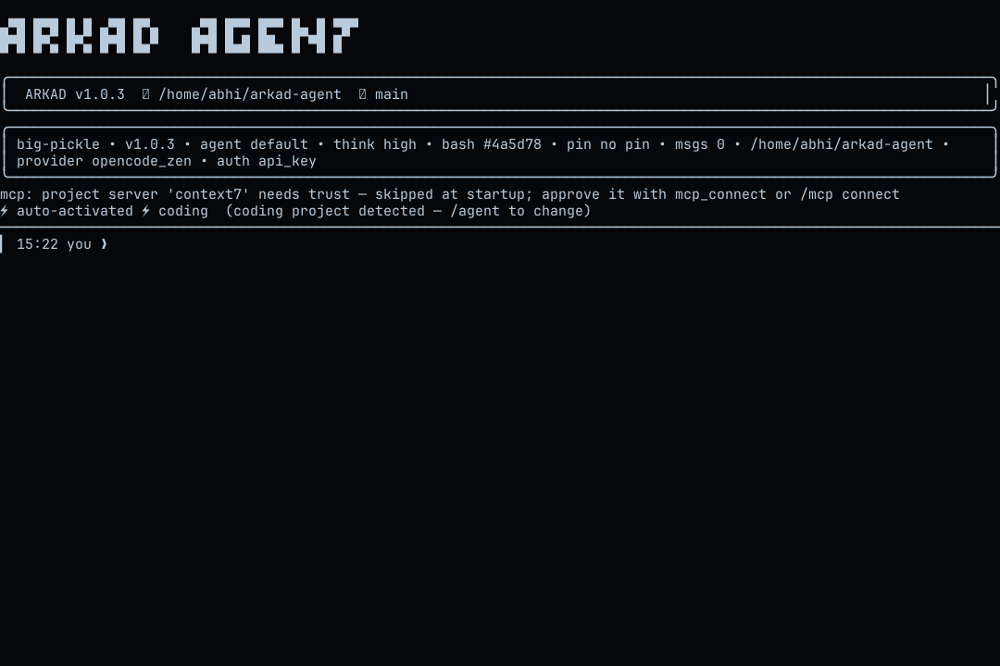
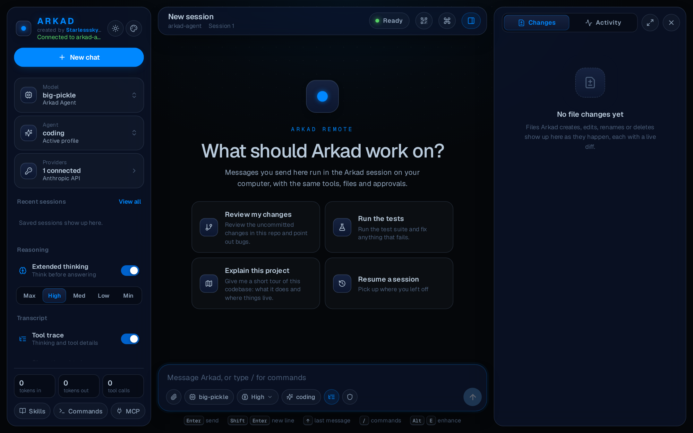
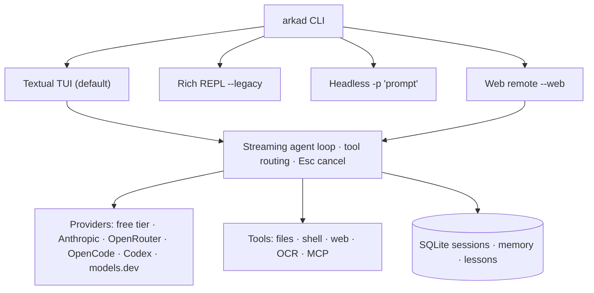

<p align="center">
  
</p>

<h1 align="center">Arkad Agent</h1>

<p align="center">
  <a href="https://www.python.org/downloads/"></a>
  <a href="LICENSE"></a>
  <a href="https://github.com/StarlessskyNight/arkad-agent/blob/main/arkad/constants/models.py"></a>
</p>



## About

**Arkad Agent** is a terminal-native AI coding agent: it reads your project, plans the work, edits files, runs commands, and checks its own output. A Textual TUI is the default; a legacy REPL, headless one-shots, and a mobile-friendly browser remote share one streaming agent loop. Fresh installs run on a **free tier with no API key** — connect Anthropic, OpenRouter, OpenCode, Codex, or any [models.dev](https://models.dev/) provider when you want one. Local-first, no telemetry.

One Python package — no daemon, no account, everything stays on disk.

## Features

| Area | What you get |
| --- | --- |
| **Interfaces** | Textual TUI (default), Rich REPL (`--legacy`), headless `arkad -p "…"`, browser remote (`--web`, `--tunnel` for a public link) |
| **Models** | Free Arkad Agent tier by default; opt-in Anthropic, OpenRouter, OpenCode Go/Zen, OpenAI Codex, plus ~200 models.dev providers |
| **Agent loop** | Streamed replies, live file diffs, parallel tool execution, per-turn tool routing, Esc cancels mid-turn |
| **Tools** | Files, shell with approval rules, web fetch and verified search, docs/OCR, screenshots, macOS control |
| **Extensibility** | MCP servers, Markdown skills, custom agents and commands, editor snippets for Zed, Neovim, Emacs |
| **Persistence** | SQLite session history, project context, memory and lessons — all stored locally |

## Screenshots

<!-- Real captures of the shipping interfaces, produced by scripts/_capture_screenshots.py (Textual Pilot, PTY, headless Chromium). No mockups. -->

**Terminal TUI**:



**Model picker** — live discovery via `/model`:



**Legacy REPL** (`arkad --legacy`):



**Browser remote** (`arkad --web`) — phone-friendly session mirror:



## Architecture



One process, four front-ends: every UI renders the same loop, so TUI and browser can mirror one session.

## Install

Linux / macOS:

```bash
curl -fsSL https://raw.githubusercontent.com/StarlessskyNight/arkad-agent/main/scripts/install | bash
```

Windows (PowerShell):

```powershell
powershell -ExecutionPolicy ByPass -c "irm https://raw.githubusercontent.com/StarlessskyNight/arkad-agent/main/scripts/install.ps1 | iex"
```

From a checkout:

```bash
python3 -m venv .venv
.venv/bin/pip install -e .
.venv/bin/arkad          # or: arkad
```

Uninstall (removes install, config, data, shims, and PATH entries):

```bash
# Linux / macOS
curl -fsSL https://raw.githubusercontent.com/StarlessskyNight/arkad-agent/main/scripts/uninstall | bash
```

```powershell
# Windows (PowerShell)
powershell -ExecutionPolicy ByPass -c "irm https://raw.githubusercontent.com/StarlessskyNight/arkad-agent/main/scripts/uninstall.ps1 | iex"
```

## Usage

```bash
arkad                      # TUI
arkad --legacy             # Rich REPL
arkad -p "fix the tests"   # headless run, then exit
arkad --web                # browser remote (loopback + token)
arkad update               # self-update
```

In-session: `/model`, `/key`, `/provider` switch backends; `/mcp`, `/agent`, `/skill`, `/memory` extend them.

## Configuration

| Variable | Default | Purpose |
| --- | --- | --- |
| `ARKAD_PROVIDER` | *(auto)* | Pin a provider: `anthropic`, `openrouter`, `opencode`, `opencode_zen`, `openai_codex`, `md:<id>` |
| `CLAUDE_MODEL` | free-tier default | Override the startup model |
| `ARKAD_WEB_HOST` | `127.0.0.1` | Bind address for `--web` |
| `ARKAD_MAX_ITERATIONS` | `50` | Runaway guard per turn |
| `ARKAD_MODELS_DEV` | on | Set `0` to disable the models.dev catalog |

Keys live in the environment or `~/.config/arkad-agent/provider`; project `.mcp.json` servers require approval before running.

## Extending & contributing

Drop Markdown into `.arkad/` (agents, skills, commands) or `~/.arkad/`. New tools live in `arkad/tools/` — schema plus dispatch. Development:

```bash
python3 -m venv .venv && .venv/bin/pip install -e ".[dev]"
.venv/bin/python -m pytest tests -q
```

Issues and pull requests are welcome.

### Acknowledgements

Provider and model details (context size, prices, tool support) come from [models.dev](https://models.dev/), an open database by the OpenCode team (MIT licence, © models.dev).

## License

GNU GPL v3.0 — see [LICENSE](LICENSE).
